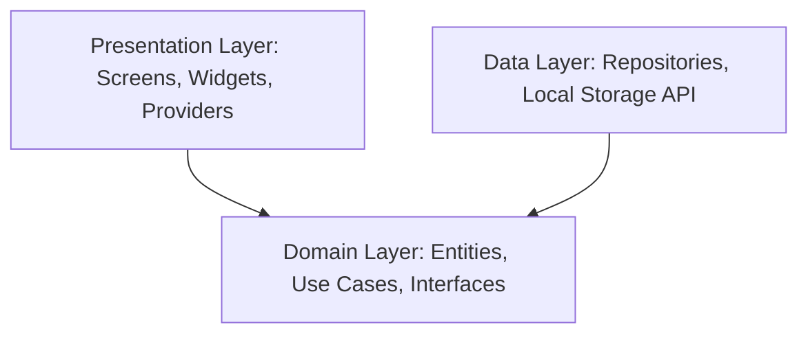

# 🛠️ Hudas 3D Buddy — 3D Printing Cost Calculator

[](https://flutter.dev)
[](https://dart.dev)
[](https://riverpod.dev)
[](LICENSE)

**Hudas 3D Buddy** is a feature-rich, professional-grade 3D printing cost calculator and management application built using **Flutter**. Designed for freelancers, makers, hobbyists, and print farm operators, the app provides precise, granular cost estimation and client quoting for 3D printing projects. It goes beyond simple material usage calculations by incorporating electricity, machine depreciation, pre/post-processing labor, markup, and tax margins.

---

## 🚀 Core Features

- **📊 Comprehensive Cost Engine:**
  - **Material Costs:** Calculates exact cost based on spool weight, purchase price, and filament used.
  - **Machine Depreciation:** Factors in printer purchase price, lifetime expectations, and hourly wear rates.
  - **Power Consumption:** Estimates electricity cost based on local utility rates (kWh) and active printer wattage.
  - **Labor Rates:** Custom rates for pre-processing (slicing, 3D modeling) and post-processing (support removal, sanding, painting, coating, assembly).
  
- **🖨️ Printer Profile Management:**
  - Save and manage profiles for multiple printers (e.g., Bambu Lab X1C, Creality Ender 3, Prusa MK4).
  - Configure average power draw (Watts), wear/depreciation factors, and custom printer tags.

- **🧵 Filament Inventory Tracker:**
  - Track active and archived spools.
  - Supports multiple materials: PLA, ABS, PETG, TPU, Nylon, and more.
  - Real-time cost-per-gram calculation.

- **📑 PDF Invoice & Quote Generator:**
  - Export professional PDF quotes and invoices for clients directly from the application.
  - Native print and share capabilities.

- **📜 History & Comparison Logging:**
  - Local storage of past calculations.
  - Review detailed breakdowns of prior jobs, duplicate them, or edit parameters to refine quotes.

- **📱 Premium UI/UX:**
  - Fluid, micro-animations using `flutter_animate`.
  - Modern, responsive forms with field validation (`flutter_form_builder`).
  - Swipable actions via `flutter_slidable` for quick item management.

---

## 🏗️ Architecture & Design Patterns

The project is structured according to **Clean Architecture** guidelines, promoting testability, maintainability, and clear separation of concerns.



### Layer Breakdown

1. **`presentation/`**
   - **Screens:** Interactive UI for calculators, printers list, filaments list, history, and settings.
   - **Widgets:** Specialized custom form elements, sliders, and interactive cards.
   - **Providers:** Modern state management powered by **Riverpod** with code generation (`riverpod_generator`).

2. **`domain/`**
   - **Entities:** Clean Dart models (e.g., `PrinterEntity`, `FilamentEntity`, `PrintJobEntity`) defining core data structures, using `Equatable` for value comparison.
   - **Repositories:** Abstract interfaces defining database and preferences contracts.

3. **`data/`**
   - **Repositories:** Implementations of domain interfaces.
   - **Data Sources:** Local persistence handlers utilizing `shared_preferences` and secure JSON serialization.

---

## 🛠️ Tech Stack & Key Libraries

| Category | Package / Tool | Purpose |
| :--- | :--- | :--- |
| **Framework** | [Flutter SDK](https://flutter.dev) | Cross-platform UI compilation |
| **State Management** | [Riverpod (v3)](https://riverpod.dev) | Compile-safe state management & DI |
| **Routing** | [GoRouter](https://pub.dev/packages/go_router) | Declarative routing system |
| **Forms** | [Form Builder](https://pub.dev/packages/flutter_form_builder) | Robust stateful form handling |
| **Animations** | [Flutter Animate](https://pub.dev/packages/flutter_animate) | Declarative micro-interactions & transitions |
| **PDF & Printing** | [pdf](https://pub.dev/packages/pdf) & [printing](https://pub.dev/packages/printing) | Native document generation and printing |
| **Storage** | [Shared Preferences](https://pub.dev/packages/shared_preferences) | Key-value offline configuration storage |
| **Monetization** | [Google Mobile Ads](https://pub.dev/packages/google_mobile_ads) | Integrated ad networks |
| **Code Generation** | [Build Runner](https://pub.dev/packages/build_runner), [Freezed](https://pub.dev/packages/freezed), [Riverpod Generator](https://pub.dev/packages/riverpod_generator) | Compile-time class generation and type-safety |

---

## ⚙️ Getting Started

### Prerequisites

- Flutter SDK: `>= 3.0.0`
- Dart SDK: `>= 3.0.0 < 4.0.0`

### Installation & Run

1. **Clone the repository:**
   ```bash
   git clone https://github.com/yourusername/hudas-3d-buddy.git
   cd hudas-3d-buddy
   ```

2. **Fetch packages:**
   ```bash
   flutter pub get
   ```

3. **Generate boilerplate & state models:**
   This project relies on compile-time code generation for serialization and state handling.
   ```bash
   flutter pub run build_runner build --delete-conflicting-outputs
   ```

4. **Run the app:**
   ```bash
   flutter run
   ```

---

## 💼 Portfolio Showcase Highlight

### Why this project stands out:
* **Deep Domain Integration:** Rather than a simple counter or CRUD app, this utility implements real-world physics, electrical math, and financial equations (markup margins, failure rates, amortization schedules).
* **Strong Clean Architecture:** Separation of domain models ensures the app logic remains fully decoupled from UI widgets or local storage frameworks, making it easy to test or migrate to cloud backends like Firebase or Supabase in the future.
* **Refined UX Details:** Smooth scroll transitions, tactile swipable actions, cohesive iconography, and structured PDF generation showcase attention to client-facing details.
